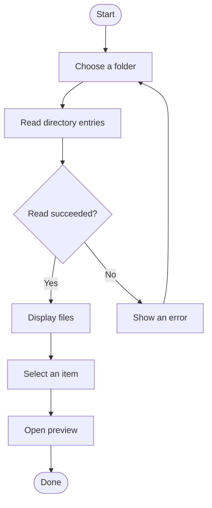
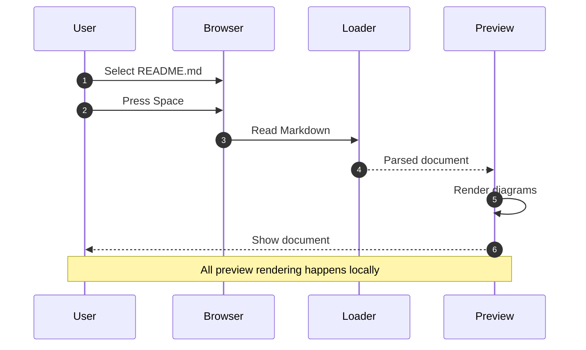
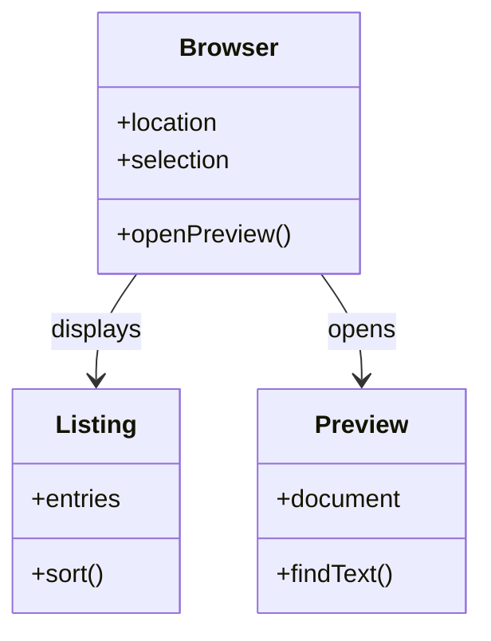
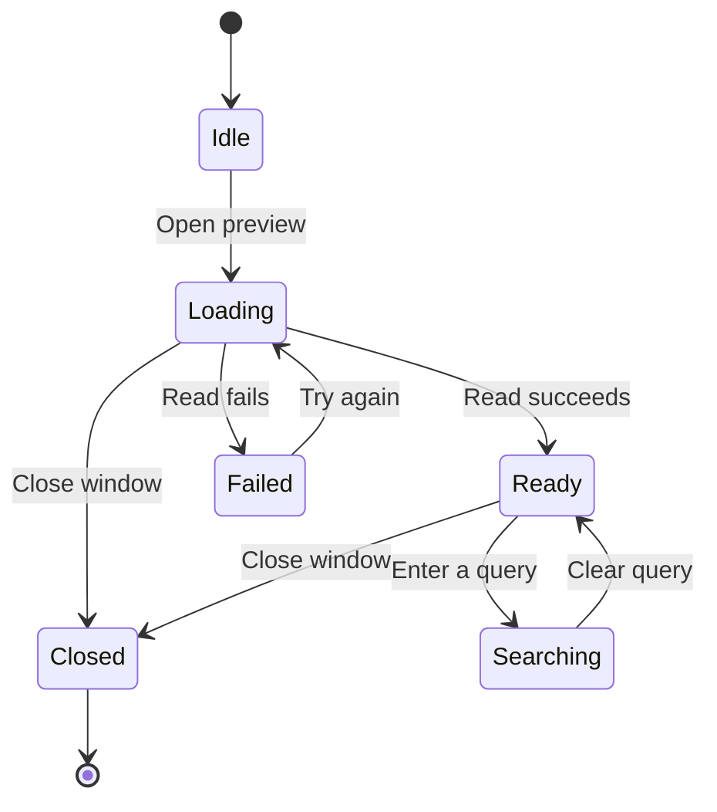
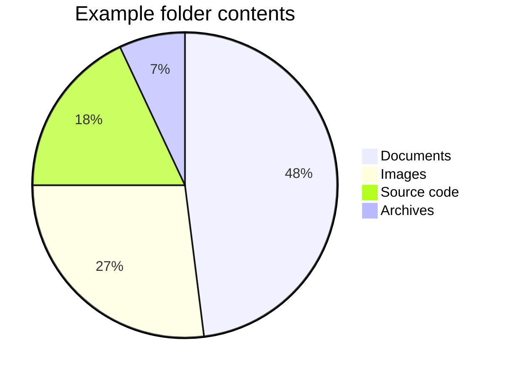

# Mermaid diagrams

This file contains five different diagram types. Each fenced block should appear as a diagram.

## 1. Flowchart

## 2. Sequence diagram

## 3. Class diagram

## 4. State diagram

## 5. Pie chart

## After the diagrams

This paragraph should still appear after the final diagram. Try resizing the window and changing the appearance while this file is open.
