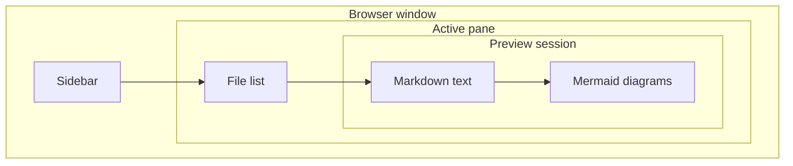

# Nested Mermaid diagrams

This document exercises Markdown nesting as well as nesting inside a diagram.

## 1. Diagram inside a blockquote

> A quoted description of the preview flow.
>
> ```mermaid
> flowchart LR
>     File[Markdown file] --> Parser[Block parser]
>     Parser --> Renderer[Native renderer]
>     Renderer --> Window[Preview window]
> ```
>
> This sentence should stay inside the same quote, below the diagram.

A normal paragraph outside the quote.

## 2. Diagram inside a quote inside another quote

> Outer quote.
>
> > Inner quote with a sequence diagram.
> >
> > ```mermaid
> > sequenceDiagram
> >     participant Reader
> >     participant Cache
> >     Reader->>Cache: Request document
> >     Cache-->>Reader: Return document
> > ```
> >
> > End of the inner quote.
>
> End of the outer quote.

## 3. Diagram inside an unordered list

- **Read a folder.** The diagram belongs to this list item.

  ```mermaid
  flowchart TD
      Open[Open folder] --> Read[Read entries]
      Read --> Sort[Apply ordering]
      Sort --> Show[Show rows]
  ```

  This paragraph still belongs to the first item.

- **Select a file.** This is the next item, outside the diagram.

## 4. Diagram inside a nested list

- **Preview pipeline**
  - **Render stage**

    ```mermaid
    flowchart LR
        Source[Source] --> Blocks[Blocks]
        Blocks --> Text[Native text]
        Blocks --> Image[Diagram image]
    ```

    Text after the nested diagram.

  - **Search stage** uses the rendered document text.

## 5. Diagram inside a list inside a blockquote

> - **A quoted list item**
>
>   ```mermaid
>   flowchart LR
>       Request[Request] --> Work[Background work]
>       Work --> Result[Result]
>   ```
>
> - A second item in the quoted list.

## 6. Nested subgraphs inside Mermaid



## End marker

If this heading and paragraph remain visible, the nested fences did not consume the rest of the document.
