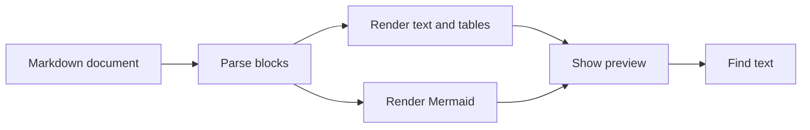

# Preview Project

A small README combining **formatted text**, *emphasis*, `inline code`, a diagram, tables, lists, and quotes.

## Overview



## Tasks

- [x] Open this file with Space.
- [x] Check the diagram above.
- [ ] Resize the window and inspect the table below.
- [ ] Search for the word `preview`.
- [ ] Switch appearance and verify the diagram remains visible.

## Components

| No | Component | Responsibility |
| --: | :-- | :-- |
| 1 | Browser | Keep the current folder, selection, and view together. |
| 2 | Reader | Load the document and parse its blocks away from the main thread. |
| 3 | Renderer | Present headings, prose, code, tables, quotes, and diagrams. |
| 4 | Search | Highlight text without changing the underlying document. |

## A quoted walkthrough

> A preview request belongs to the file you opened.
>
> 1. Read the selected file.
> 2. Render its blocks.
> 3. Display the result if the preview is still open.
>
> ```mermaid
> flowchart TD
>     Request[Preview request] --> Read[Read file]
>     Read --> Render[Render content]
>     Render --> Current{Still current?}
>     Current -->|Yes| Show[Show result]
>     Current -->|No| Ignore[Ignore old result]
> ```

## Example Swift

```swift
struct PreviewItem {
    let name: String
    let isFolder: Bool
}

let item = PreviewItem(name: "README.md", isFolder: false)
print(item.name)
```

## Example JSON

```json
{
  "name": "Preview Project",
  "features": ["mermaid", "tables", "find"],
  "offline": true
}
```

## A few typography checks

Normal text, **bold text**, *italic text*, ~~struck-through text~~, and `monospaced text`.

Unicode: café, résumé, Straße, Ελληνικά, 中文, 日本語, 한국어.

---

## Final section

The final section should remain reachable after all the diagrams and tables above.
