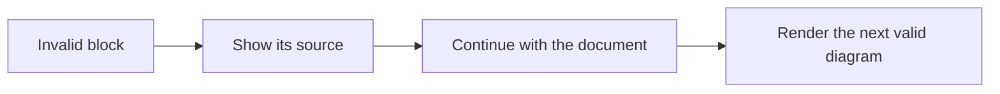

# Diagram fallbacks

The first Mermaid block is intentionally invalid. It should remain visible as source code rather than preventing the rest of the document from displaying.

## Intentionally invalid Mermaid

```mermaid
this is deliberately not valid mermaid syntax
```

## A valid diagram after the invalid one

This diagram should still render normally.



## Ordinary code should stay code

```javascript
const example = "This is a JavaScript block, not a diagram";
console.log(example);
```

## Following table

| No | Check | Expected result |
| --: | :-- | :-- |
| 1 | Invalid diagram | Its source remains readable. |
| 2 | Valid diagram | It renders after the invalid block. |
| 3 | Code fence | JavaScript remains a code block. |
| 4 | Remaining document | This table and the end marker are visible. |

## End marker

You reached the end of the fallback sample.
